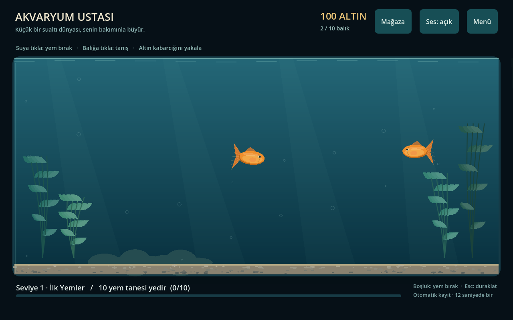

# Akvaryum Ustası 🐠

Türkçe arayüzlü, Canvas tabanlı bir akvaryum ve balık besleme oyunu. Balıklarını besle ve büyüt, altın kabarcıklarını topla, yeni türler ve dekorlarla akvaryumunu geliştir.

## Godot sürümü

Godot'ta açılacak proje **[`godot/project.godot`](godot/project.godot)** dosyasıdır. Godot 4.7.2 ile test edildi. [Açma ve oynama rehberi](godot/README.md) · [Geliştirme planı](godot/GELISTIRME_PLANI.md).



Godot sürümü yerel kayıtla çevrimdışı çalışır. Aşağıdaki npm ve veritabanı adımları web sürümü içindir.

## Özellikler

- Sekiz balık türü, büyüme ve seviye sistemi
- Balık satın alma, isim verme ve dekorasyon
- Ses efektleri ve dokunmatik / fare kontrolleri
- Prisma ve SQLite ile otomatik kayıt

## Gereksinimler

Node.js 22 veya üzeri ve npm.

## Yerel kurulum

```sh
git clone https://github.com/oktaycosar/akvaryum-ustasi.git
cd akvaryum-ustasi
npm ci
```

`.env.example` dosyasını `.env` adıyla kopyala. Windows PowerShell'de:

```powershell
Copy-Item .env.example .env
```

macOS / Linux'ta:

```sh
cp .env.example .env
```

Ardından veritabanını oluştur ve oyunu başlat:

```sh
npm run db:generate
npm run db:push
npm run dev
```

Tarayıcıda http://localhost:3000 adresini aç. SQLite veritabanı `prisma/dev.db` konumunda oluşturulur; kayıt dosyaları GitHub'a yüklenmez.

## Kontroller

Akvaryuma tıklayarak / dokunarak yem bırak. Balıkları ve altın kabarcıklarını seç; mağazadan balık ve dekor satın al. Ses düğmesiyle ses efektlerini açıp kapat.

## Kontrol ve üretim

```sh
npm run lint
npm run typecheck
npm run build
npm start
```

## Teknolojiler

Next.js 16, React 19, TypeScript, Tailwind CSS, Zustand, HTML Canvas, Web Audio, Prisma ve SQLite.

## Kayıt sistemi ve barındırma

Mevcut sürüm tek bir ortak oyun kaydı kullanır; kullanıcı hesabı ve oyuncu bazlı kayıt ayrımı içermez. Aynı sunucuya bağlanan ziyaretçiler aynı kaydı okuyup değiştirebilir. Bu sürüm yerel kullanım / tek oyunculu deneme için uygundur. Çok kullanıcılı bir yayına almadan önce kimlik doğrulama ve oyuncu bazlı kayıt eklenmelidir.

Sunucuda SQLite dosyası için kalıcı, yazılabilir disk gerekir. GitHub deposu kaynak kodunu barındırır; bu proje doğrudan GitHub Pages üzerinde çalışmaz. İlk derlemede Google Fonts için internet bağlantısı gerekir.

## Haklar

Proje sahibi: [oktaycosar](https://github.com/oktaycosar). Bu depoya henüz açık kaynak lisansı eklenmemiştir. Bağımlılıkların kendi lisansları geçerlidir.
